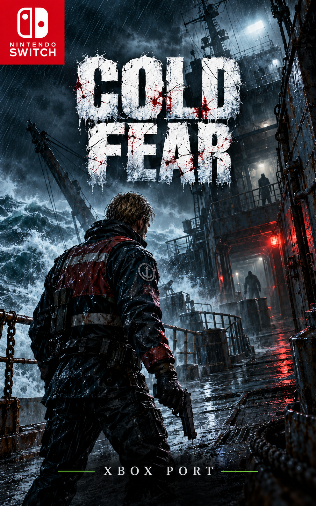
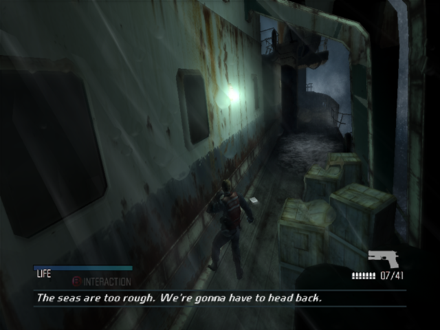
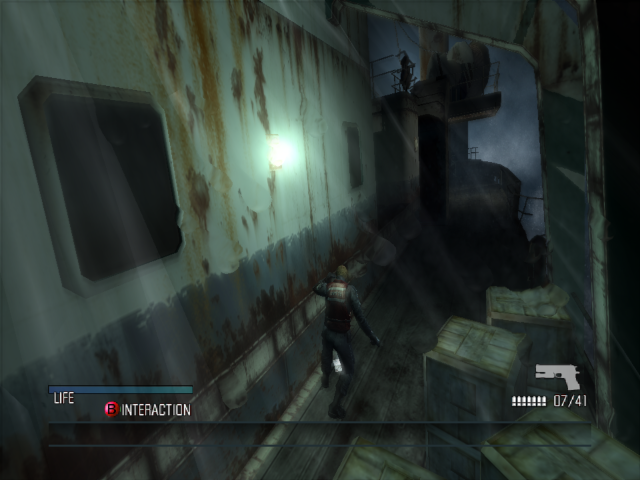

<div align="center">



# Cold Fear (Xbox) for Nintendo Switch

A static recompilation port of the original Xbox Cold Fear, running natively on the Switch.

   [](https://ko-fi.com/gerissoncassiano)

[Português (BR)](README.md) · **English** · [Español](README.es.md)

[Features](#status) · [Play](#play) · [Building](#building-new-port-kit-folder) · [Changelog](CHANGELOG.md) · [Support](#support-the-project)

</div>

---

An experimental static recompilation port: the Xbox's x86 executable is turned into C++ and compiled for ARM64 with the [XboxSwitchPortKit](kit/) and a Vulkan (NVK) renderer. This is not emulation: the game's code runs natively, and the Xbox libraries (Direct3D 8, DirectSound, kernel) are rewritten for the Switch.

> **This repository does not contain the game.** The disc files, the XBE and the C code generated from it are not distributed. To build or play you need your own copy of Cold Fear (Xbox).

## Support the project

The port is free and open source. If you would like to support the development time and the testing on real hardware, you can donate on Ko-fi:

[](https://ko-fi.com/gerissoncassiano)

From Brazil you can also use **PIX** (email key): `pocketneogames@gmail.com` — QR code in the [Portuguese README](README.md#apoie-o-projeto).

Donations are optional: nobody has to donate to play, and the project neither includes nor sells the game.

## Status

Playable on a real Switch, from the menu into gameplay, at 30 FPS most of the time.

Since version 0.1 the port has been rebuilt on the **XboxSwitchPortKit** (the [`kit/`](kit/) folder): instead of emulating the NV2A GPU, the Xbox's Direct3D 8 and DirectSound are rewritten directly over Vulkan (NVK) and the Switch's audio. The old port (0.0.x, with NV2A emulation) stays in the repository root for reference.

What 0.1.37 has:

- **Gyro aiming:** hold **ZL** (aim) and move the console. The turn goes straight into the game's aim angles, one to one, with none of the stick's dead zone or acceleration. Options: sensitivity, vertical speed, axis (turn / lean / both), steadiness (filters hand shake), drift correction and invert X/Y.
- **Lamp shadows** fixed: the player and objects cast shadows, without the dark straight-edged areas seen before.
- **OLED screen:** an OLED SCREEN BOOST option (AUTO / OFF / ON) that lifts the dark tones. On AUTO it turns on by itself on a Switch OLED in handheld mode and off when docked.
- **Port menu:** hold **−** and press **R3**. Render resolution, screen filter, brightness, V-Sync, FPS cap, FPS counter, anisotropic filtering, shadows, stick dead zones and sensitivity, audio output and the gyro options.
- Black bars only in gameplay (as in the original); menus fill the screen.
- Audio: effects, voices and music.
- Cover art in the Switch menu.
- No overclock.

Performance measured on a Switch (handheld, 100% resolution): 30 FPS for most of the game; heavy areas drop to 23–26 FPS for a few seconds, as do loads and the first time an effect appears. Every 300 frames the log records the FPS and where the time went (game code, GPU, idle).

Known issues:

- FPS drops in the heaviest areas: the dynamic resolution reacts late.
- The port's options are only in the **− + R3** menu, not yet inside the game's own menu.

## Screenshots

Taken from the PC test build, which uses the same game code and renderer as the Switch.

<p align="center"> </p>

## Controls

The controls are the original game's. The port adds:

| Button | What it does |
| --- | --- |
| Hold **ZL** | Aim; the gyro moves the aim while it is held |
| **−** + **R3** | Open the port menu |
| Left / right in the menu | Change the option's value |

## Game version used

The port was made and tested with this version. Other regions or revisions may not work, because the code depends on the exact executable.

| Field | Value |
| --- | --- |
| Game | Cold Fear (Xbox, Ubisoft, 2005) |
| Region | NTSC-U (USA) |
| Title ID | `0x5553004B` (US-075) |
| Certificate version | 1 |
| XBE built | 2005-02-06 (XDK 5849) |
| `default.xbe` | 3,624,960 bytes |
| `default.xbe` SHA-256 | `7371e422ecd0ac5c95ebaa343a6a9c3d504f2f261a53ed8acf212f258ab377ef` |

To check your copy in PowerShell:

```powershell
Get-FileHash .\game\default.xbe -Algorithm SHA256
```

## Play

You need your own copy of Cold Fear (Xbox, NTSC-U). **From 0.1 on the `.nro` is not distributed here**, because it contains the recompiled game code: build your own (next section).

```text
sdmc:/switch/coldfear/
  coldfear.nro
  game/              <- the disc files (default.xbe, bigfile.bin, DATA/...) or an .iso
  logs/              <- created by the port
```

Open it from hbmenu **while holding R on an installed game** (title mode, with all the memory).

Controls: the original game's. **ZL** aims (and turns the gyro on), **− + R3** opens the port menu.

## Building (new port, `kit/` folder)

`kit/` holds the port's and the kit's code, without the game and without the large binaries:

| Folder | What it is |
| --- | --- |
| `kit/exemplos/coldfear/` | The port: Direct3D 8 and DirectSound HLE, gyro, shadows, OLED, menu (`src/`), `port.cmake`, `config/game.toml`, cover. `HANDOFF.md` has the development notes (Portuguese). |
| `kit/host-switch/` | The Switch layer: Vulkan/NVK, audio, controllers, gyro, ImGui. |
| `kit/host-pc/` | A Windows test build with the same game code and renderer, to find bugs without the console. |
| `kit/sdk/XboxXBE-Recomp/` | The recompiler and runtime ([TGP482/XboxXBE-Recomp](https://github.com/TGP482/XboxXBE-Recomp), MIT), with the changes for the Switch. |
| `kit/ferramentas/`, `kit/docs/` | Scripts to recompile, build and package, and the kit's documentation (Portuguese). |

Not in the repository, for size or because they come from the game: `nvk/` (the Mesa NVK driver built for the Switch), `third_party/` (glslang, Dear ImGui, toml++), `exemplos/coldfear/assets/default.xbe` and `exemplos/coldfear/generated/` (the C++ generated from your xbe).

Steps (details in [`kit/LEIA-ME.md`](kit/LEIA-ME.md) and [`kit/docs/`](kit/docs/)):

1. Copy `kit/` to a path with no accents or spaces, such as `C:\XboxSwitchPortKit`, and add `nvk/` and `third_party/`.
2. Install Visual Studio 2022 Build Tools with Clang and devkitPro with `switch-dev` ([requirements](kit/docs/01-requisitos.md)).
3. Put your `default.xbe` in `exemplos\coldfear\assets\`.
4. Recompile, build and package:

```powershell
powershell -ExecutionPolicy Bypass -File C:\XboxSwitchPortKit\ferramentas\recompilar.ps1 C:\XboxSwitchPortKit\exemplos\coldfear
```

```bash
/c/devkitPro/msys2/usr/bin/bash.exe -lc 'cd /c/XboxSwitchPortKit && JOBS=8 ./ferramentas/build_switch.sh exemplos/coldfear'
```

```powershell
powershell -ExecutionPolicy Bypass -File C:\XboxSwitchPortKit\ferramentas\empacotar.ps1 C:\XboxSwitchPortKit\exemplos\coldfear
```

The result is `sd\switch\coldfear\coldfear.nro`.

## Repository layout

| Folder | Contents |
| --- | --- |
| `kit/` | The current port (0.1.x) and the kit used to build it |
| `src/`, `xboxrecomp/`, `switch/`, `tools/`, `config/` | The old port (0.0.x), with NV2A emulation |
| `docs/` | Component provenance (`PROVENANCE.md`) and the old port's notes (`port-antigo/`) |
| `artwork/` | Cover and icon |
| `CHANGELOG.md` | Version history (Portuguese) |

## Changelog

See [CHANGELOG.md](CHANGELOG.md) (Portuguese).

## Old port (0.0.x)

The code in the root (`src/`, `xboxrecomp/`, `switch/`, `tools/`) is the first port, with NV2A GPU emulation, stopped at 0.0.3 (22–30 FPS). Its instructions are in `docs/port-antigo/BUILD_STATUS.md` and in this README's history.

## Licenses and provenance

- New port: XboxXBE-Recomp (MIT), Black-Android, the base of `kit/exemplos/coldfear/src/common` (MIT, `kit/exemplos/coldfear/LICENSE-Black-Android`), Mesa/NVK (MIT), glslang, Dear ImGui and toml++ under their own licenses.
- Old port: see `docs/PROVENANCE.md`; the xboxrecomp toolkit keeps its licenses in `xboxrecomp/LICENSE`, `xboxrecomp/NOTICE` and `xboxrecomp/LICENSES/`; the rest follows `LICENSE` and `NOTICE` in the root.
- Do not distribute the game files, the ISO, the generated code or a built `.nro`.
